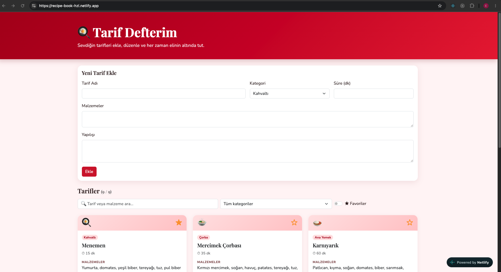
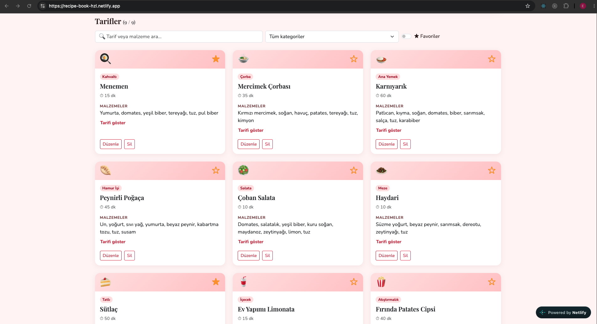
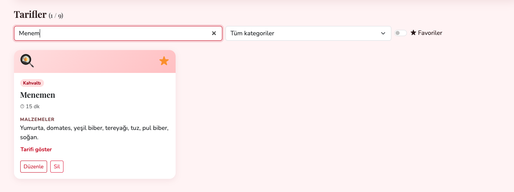
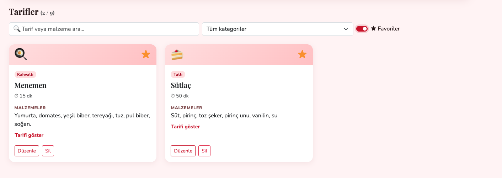
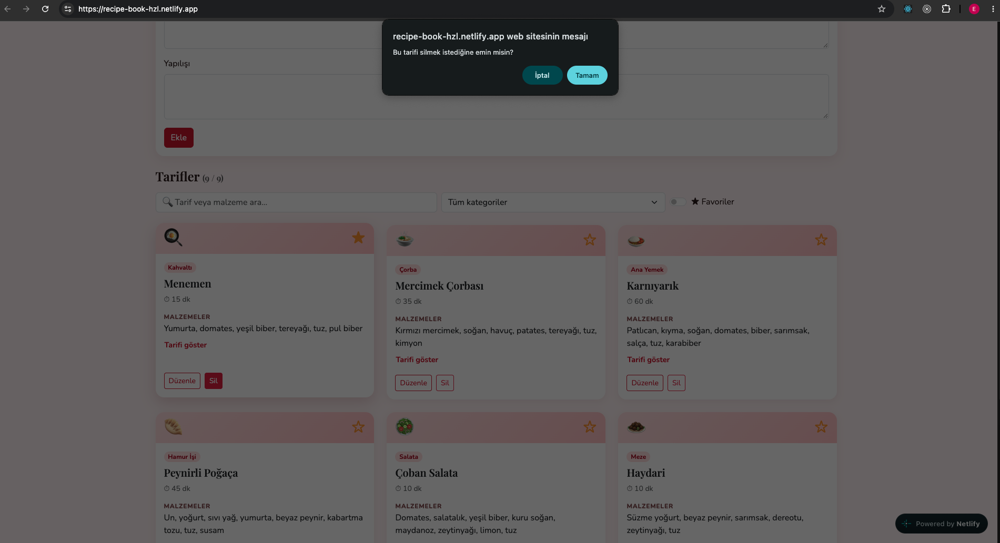

# Recipe Book

[Türkçe README](README.tr.md)

A recipe management web app built with React, Vite and Bootstrap 5.
Users can add, list, edit and delete their favorite recipes. All data is stored in the browser with LocalStorage.

## Live Demo

https://recipe-book-hzl.netlify.app

## Features

- **Create:** add a new recipe with name, category, duration, ingredients and instructions
- **Read:** list all recipes as cards, expand a card to see the instructions
- **Update:** edit an existing recipe
- **Delete:** remove a recipe after a confirmation prompt
- **Search:** filter recipes by name or ingredient
- **Category filter:** show recipes from a single category
- **Favorites:** mark recipes with a star and filter by favorites
- **Persistence:** data is kept in LocalStorage, so recipes stay after a page refresh

## Tech Stack

- React
- Vite
- Bootstrap 5
- LocalStorage
- Deployed on Netlify

## Screenshots

### Home and add form



### Recipe list



### Search



### Favorites filter



### Delete confirmation



## Getting Started

```bash
git clone https://github.com/KULLANICI-ADIN/recipe-book.git
cd recipe-book
npm install
npm run dev
```

## Project Structure

```
src/
  components/   reusable UI parts (RecipeForm, RecipeCard, RecipeList)
  pages/        page components (Home)
  interfaces/   data shapes
```
