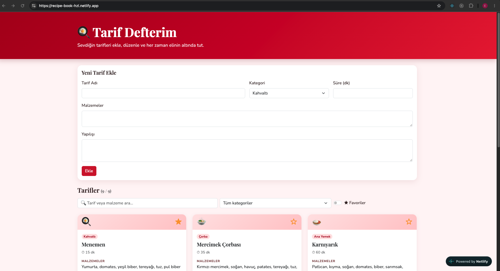
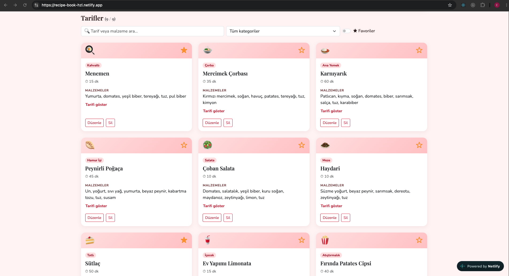
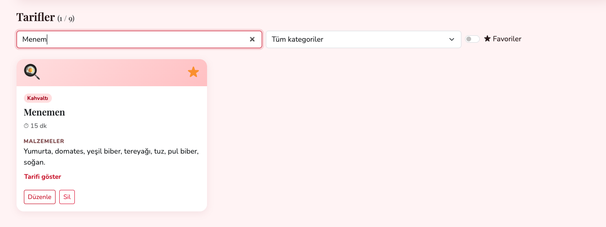
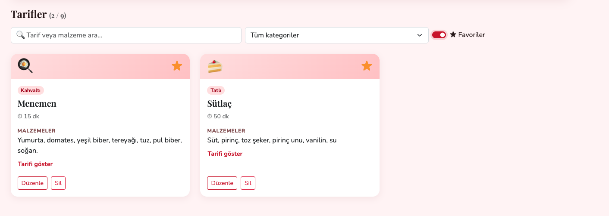
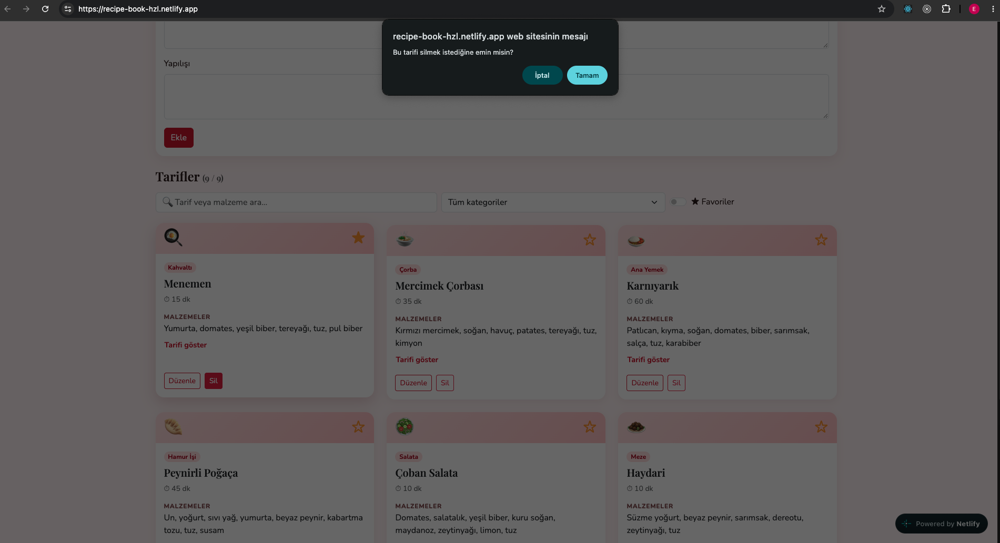

# Recipe Book

[English version](README.md)

React, Vite ve Bootstrap 5 ile geliştirilmiş bir tarif yönetimi web uygulaması.
Kullanıcılar en sevdikleri tarifleri ekleyebilir, listeleyebilir, düzenleyebilir ve silebilir. Tüm veriler tarayıcıda LocalStorage ile saklanır.

## Canlı Demo

https://recipe-book-hzl.netlify.app

## Özellikler

- **Oluşturma:** ad, kategori, süre, malzemeler ve yapılış ile yeni tarif ekleme
- **Okuma:** tüm tarifleri kart olarak listeleme, yapılışı görmek için kartı genişletme
- **Güncelleme:** var olan bir tarifi düzenleme
- **Silme:** onay sorusundan sonra tarifi kaldırma
- **Arama:** tarifleri ada veya malzemeye göre filtreleme
- **Kategori filtresi:** yalnızca tek bir kategorinin tariflerini gösterme
- **Favoriler:** tarifleri yıldızla işaretleme ve favorilere göre filtreleme
- **Kalıcılık:** veriler LocalStorage'da tutulur, bu yüzden sayfa yenilense de tarifler kaybolmaz

## Teknolojiler

- React
- Vite
- Bootstrap 5
- LocalStorage
- Netlify üzerinde yayında

## Ekran Görüntüleri

### Ana sayfa ve ekleme formu



### Tarif listesi



### Arama



### Favoriler filtresi



### Silme onayı



## Başlarken

```bash
git clone https://github.com/hazalbuber/recipe-book.git
cd recipe-book
npm install
npm run dev
```

## Proje Yapısı

```
src/
  components/   yeniden kullanılabilir arayüz parçaları (RecipeForm, RecipeCard, RecipeList)
  pages/        sayfa bileşenleri (Home)
  interfaces/   veri şekilleri
```
